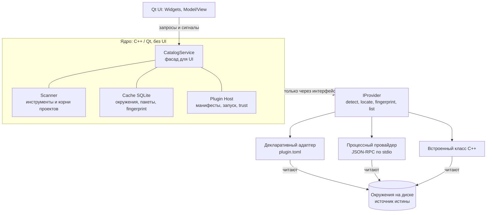

# Package Browser — дизайн приложения

> Настольное приложение на C++/Qt 6, которое показывает пакеты разных менеджеров (pip, npm, vcpkg и других) и всегда отвечает на вопрос «из какого окружения этот пакет»: глобального или конкретного проекта.

## Зачем это нужно

На одной машине одновременно живёт несколько «миров» пакетов: системный Python с глобальным pip, виртуальное окружение `.venv` в каталоге проекта со своим pip и своими пакетами, глобальные и локальные пакеты npm, vcpkg в classic- и manifest-режимах. Каждый менеджер показывает только свой мир и не знает про остальные, поэтому вопрос вроде «где у меня установлен `requests` и какой версии?» приходится решать вручную: перебирать каталоги и запускать команды по очереди.

Приложение собирает всё это в одном месте. Две идеи делают его полезным и расширяемым:

1. **Окружение (где лежат пакеты) и инструмент (кто ими управляет) — разные сущности.** Поэтому глобальный pip и pip из venv не путаются. См. [[Доменная модель]].
2. **Поддержка менеджеров добавляется плагинами, а не правкой ядра.** См. [[Плагины и JSON-RPC]].

## Сквозной пример

Во всех заметках серии используется одна и та же машина разработчика:

| Что есть на машине | Где лежит |
| --- | --- |
| Системный Python с pip и несколькими пакетами | глобально, scope `System` |
| Проект `~/work/app` с виртуальным окружением | `~/work/app/.venv`: свой pip и свои пакеты, scope `Project` |
| npm-пакеты проекта | `~/work/app/node_modules`, scope `Project` |
| Зависимости C++ проекта | `~/work/app/vcpkg.json`, manifest-режим vcpkg |
| Глобальные npm-пакеты | глобальный prefix npm, scope `System` |

Вопрос, к которому мы будем возвращаться в каждой заметке: **«В каких окружениях установлен `requests` и какой версии?»**

## Решения для MVP

| Вопрос | Решение | Причина |
| --- | --- | --- |
| Язык и UI | C++ / Qt 6 (Widgets); запасной вариант — Java | базовый стек разработчика; `QProcess`, Qt SQL и Model/View есть в комплекте |
| Менеджеры | pip, npm, vcpkg | с ними разработчик работает сам; остальные добавляются плагинами позже |
| Платформы | Windows и Linux | нет возможности тестировать macOS |
| Список пакетов | плоский, без рёбер зависимостей | граф зависимостей — отдельный этап |
| Корни проектов | только заданные вручную | предсказуемо и быстро, без обхода всего диска |
| Режим | только чтение | действия (install, update, remove) закладываются в контракт, но не реализуются |
| Плагины | гибрид: манифест + внешний процесс | один интерфейс для ядра, любые языки для авторов плагинов |
| Хранилище | SQLite как disposable-кэш | мгновенный старт UI; источник истины — диск |
| Лицензия | GPLv3 | проще всего юридически; Qt используется под GPLv3 |

Подробное обоснование — в [[Решения и roadmap]].

## Архитектура

Ядро знает только интерфейс `IProvider`. Что стоит за ним (манифест, внешний процесс или встроенный C++ класс), ядру безразлично.

## Карта заметок

| Заметка | О чём |
| --- | --- |
| [[Доменная модель]] | сущности, scope, идентичность пакетов; главная идея «global vs project» |
| [[Плагины и JSON-RPC]] | манифесты, процессные провайдеры, как работает JSON-RPC на примере |
| [[Обнаружение окружений]] | как находить глобальные и project-local окружения |
| [[Хранилище и кэш]] | схема SQLite, инвалидация, stale-while-revalidate |
| [[UI на Qt]] | модели представления, раскладка окна, потоки |
| [[Надёжность и безопасность]] | изоляция сбоев, trust проектных каталогов |
| [[Решения и roadmap]] | trade-off'ы, лицензии Qt, этапы сборки, будущие действия |

## Когда что читать

| Задача | Куда смотреть |
| --- | --- |
| Понять, чем окружение отличается от инструмента | [[Доменная модель]] |
| Добавить поддержку нового менеджера | [[Плагины и JSON-RPC]] |
| Объяснить, почему venv не смешивается с глобальным Python | [[Доменная модель]], [[Обнаружение окружений]] |
| Разобраться, почему приложение не зависает на медленном `npm ls` | [[Хранилище и кэш]], [[UI на Qt]] |
| Решить, можно ли запускать `.venv/bin/pip` из чужого проекта | [[Надёжность и безопасность]] |
| Выбрать лицензию или понять требования Qt | [[Решения и roadmap]] |

## Ключевые термины

| Термин | Значение |
| --- | --- |
| `Ecosystem` | семейство языка или платформы (Python, JavaScript, C/C++); задаёт правила нормализации имён |
| `ManagerKind` | тип менеджера пакетов (pip, npm, vcpkg); описывается плагином |
| `ToolInstance` | конкретный исполняемый файл менеджера: путь, версия, кто его предоставил |
| `Environment` | место, где лежат установленные пакеты; имеет `scope` и `root` |
| `Scope` | уровень видимости окружения: `System`, `User`, `Project` |
| `Installation` | пакет в конкретном окружении |
| `Provider` | реализация `IProvider`: умеет находить инструменты и окружения и перечислять пакеты |
| `fingerprint` | дешёвая строка, которая меняется, когда меняется содержимое окружения |
| Trust | пометка, что в проектном каталоге разрешено запускать исполняемые файлы |

## См. также
