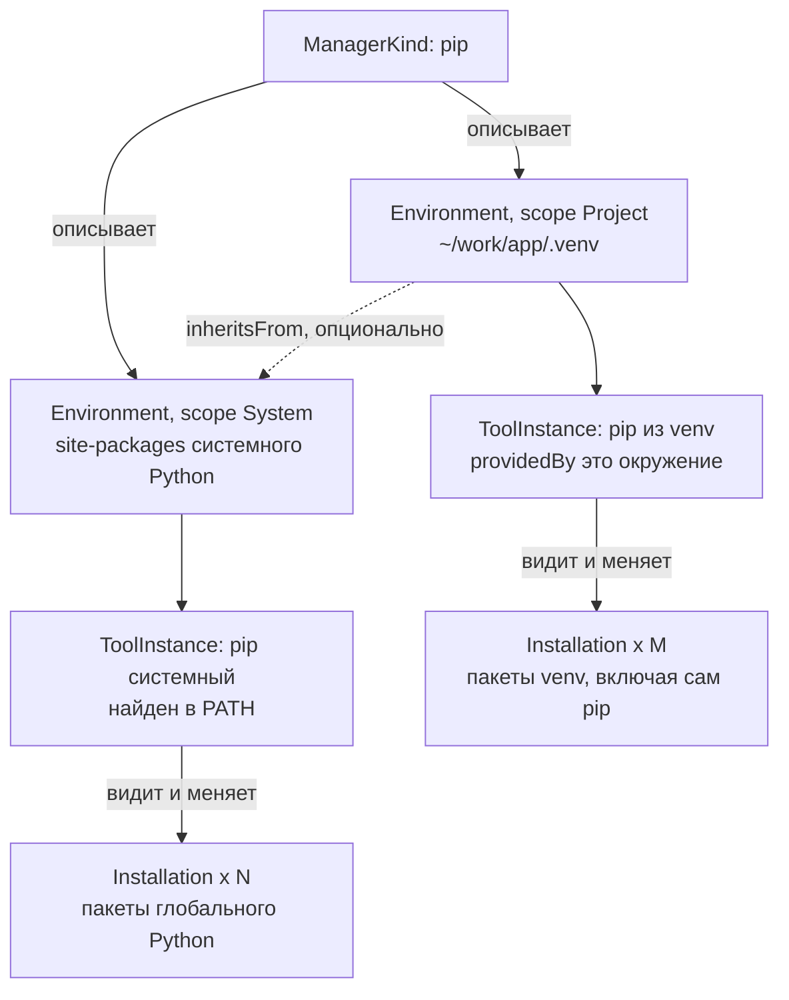

# Доменная модель

> Оригинальная серия: [[Package Browser]]

## Зачем разделять инструмент и окружение

Классическая ошибка: выполнить `pip install` и обнаружить, что пакет попал не в то окружение, где его ждали. Причина в том, что слова «pip» и «окружение» часто воспринимаются как одно. На самом деле это две разные вещи:

- **окружение** — место, где лежат пакеты (каталог `site-packages` системного Python, каталог `.venv`, `node_modules`);
- **инструмент** — программа, которая этим местом управляет (`pip`, `npm`).

Виртуальное окружение — это окружение со своим собственным экземпляром pip. Поэтому глобальный pip и pip из venv — два разных инструмента одного и того же менеджера, у каждого свой набор пакетов. Если модель этого не различает, приложение будет путать, чьи пакеты оно показывает.

## Пример на сквозной машине

Возьмём системный Python и проект `~/work/app` с `.venv` (см. [[Package Browser]]):

Ответ на вопрос «где установлен `requests`»: `requests` есть в обоих окружениях, но это две разные `Installation`, потому что принадлежат двум разным `Environment`. Версии могут не совпадать, и приложение показывает обе.

## Сущности

| Сущность | Что это | Пример |
| --- | --- | --- |
| `Ecosystem` | семейство языка или платформы; группирует менеджеры и задаёт правила нормализации имён | Python, JavaScript, C/C++ |
| `ManagerKind` | тип менеджера; описывается плагином | pip, npm, vcpkg |
| `ToolInstance` | конкретный исполняемый файл менеджера: путь, версия, кто его предоставил | системный pip; pip внутри `.venv` |
| `Environment` | место, где живут установленные пакеты: `scope`, `root`, связанный `ToolInstance` | site-packages системного Python, `./.venv`, `./node_modules` |
| `Scope` | уровень видимости окружения | `System`, `User`, `Project` |
| `Installation` | пакет в конкретном окружении: имя, версия, путь, источник, флаг «запрошен явно» | `requests` в `./.venv` |
| `DependencyEdge` | связь между двумя `Installation` внутри одного окружения | `requests` → `urllib3` |
| `Project` | вычисляемая группировка окружений по общему корню каталога | каталог с `.venv` и `node_modules` |

## Scope

| Scope | Что это | Пример |
| --- | --- | --- |
| `System` | общесистемное окружение | site-packages системного Python, глобальный prefix npm, `installed/` в корне vcpkg (classic mode) |
| `User` | окружение текущего пользователя | `pip install --user` |
| `Project` | окружение, привязанное к каталогу проекта | `.venv`, `node_modules`, manifest-режим vcpkg |

## Инварианты

Эти правила должны выполняться во всём коде:

- Окружение принадлежит ровно одному `ManagerKind`. Пакеты разных окружений не смешиваются и не дедуплицируются: `requests` в трёх venv — это три `Installation`.
- `Installation` идентифицируется парой (`EnvironmentId`, нормализованное имя), а не именем и версией. Версия — атрибут: при обновлении на месте она меняется, а идентичность остаётся.
- `ToolInstance` может быть пакетом внутри окружения (pip в venv виден и как пакет, и как инструмент). Связь `providedBy` указывает на это окружение.
- `Project` — не источник истины, а вычисляемый вид: найденные окружения группируются по ближайшему общему каталогу.
- Если venv разрешает видеть системные пакеты (`include-system-site-packages = true` в `pyvenv.cfg`), между окружениями появляется ребро `inheritsFrom`. Пакеты родителя при этом не копируются: это связь, а не дубликат. На этапе 4 это ребро заполняется для pip-venv: корень системного окружения выводится из `pyvenv.cfg` `home` (префикс базового интерпретатора, каталог, содержащий его pip — тот же корень, что строит `locate()` для системного pip), поэтому `inheritsFrom` разрешается в тот же `EnvironmentId`.

## Идентичность и нормализация имён

Одно и то же имя пакета может записываться по-разному, поэтому ядро хранит нормализованное имя и показывает исходное. Правила принадлежат экосистеме, а не ядру.

| Экосистема | Правило нормализации |
| --- | --- |
| Python | PEP 503: нижний регистр, подряд идущие `-`, `_`, `.` заменяются на один `-` |
| JavaScript | имена могут быть scoped, вида `@scope/name`; scope входит в имя |

> [!note]
> Идентификатор окружения (`EnvironmentId`) — хеш от плагина и канонического корня. Если каталог venv перенесён, получается новое окружение, а старое помечается как `missing`. Это осознанное простое поведение.

## См. также

- [[Package Browser]]
- [[Обнаружение окружений]]
- [[Хранилище и кэш]]
- [[Плагины и JSON-RPC]]
