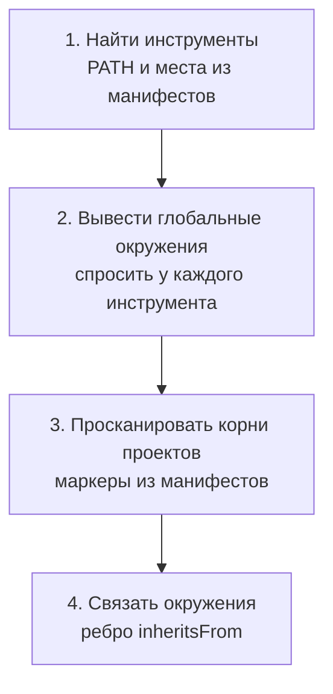

# Обнаружение окружений

> Оригинальная серия: [[Package Browser]]

## Зачем это нужно

Чтобы показать «глобальное отдельно от проектного», приложение должно само найти и те, и другие окружения. Угадывать пути глобальных установок ненадёжно: они зависят от ОС, способа установки и настроек. Поэтому глобальные окружения мы **спрашиваем у найденного инструмента**, а project-local находим сканером по файлам-маркерам из манифестов. Оба пути дают один и тот же тип результата — `Environment`, поэтому остальное приложение не отличает глобальное от локального ничем, кроме поля `scope` (см. [[Доменная модель]]).

## Пример на сквозной машине

На машине из [[Package Browser]] обнаружение проходит так:

1. В `PATH` найден системный `pip` — получаем `ToolInstance`.
2. Спрашиваем у него, куда он ставит пакеты — получаем окружения `System` и `User`.
3. В заданном вручную корне `~/work` сканер находит `~/work/app/.venv/pyvenv.cfg` — получаем окружение `Project` и отдельный `ToolInstance` (pip внутри venv).
4. В том же каталоге рядом лежат `package.json` с `node_modules` и `vcpkg.json` — получаем ещё два проектных окружения для npm и vcpkg.
5. Если в `pyvenv.cfg` стоит `include-system-site-packages = true`, между venv и системным окружением появляется ребро `inheritsFrom`.

## Алгоритм

| Шаг | Что делает | Результат |
| --- | --- | --- |
| Найти инструменты | ищет по `PATH` и по известным местам, которые заявил плагин (например, переменная `VCPKG_ROOT`); дубли склеивает по каноническому пути (`pip` и `pip3` — один `ToolInstance`) | список `ToolInstance` |
| Вывести глобальные окружения | для каждого инструмента вне проектных каталогов плагин отвечает, куда тот устанавливает пакеты; системный и пользовательский каталоги — два окружения со `scope` `System` и `User` | окружения `System` и `User` |
| Просканировать корни проектов | обход в ширину по заданным вручную корням с лимитом глубины и списком исключений; каждое совпадение с маркером из манифеста даёт `Environment` со `scope = Project`; его `ToolInstance` создаётся отдельно и помечается `providedBy` этим окружением | окружения `Project` |
| Связать окружения | если venv разрешает видеть системные пакеты, добавляется ребро `inheritsFrom`; пакеты родителя не копируются | связи между окружениями |

## Что искать у каждого менеджера

Пометка «проверить» — то, что я не мог подтвердить на вашей машине.

| Менеджер | Глобальное окружение | Project-local окружение | Маркер |
| --- | --- | --- | --- |
| pip | site-packages системного интерпретатора и user site; `pip list` показывает их вместе, различие `--user` — проверить | venv / virtualenv | `pyvenv.cfg` в корне окружения |
| npm | глобальный prefix (`npm root -g`) | `node_modules` рядом с `package.json` | `package.json` и `node_modules` |
| vcpkg | classic mode: `installed/` в корне vcpkg (`VCPKG_ROOT`) | manifest mode: проект с `vcpkg.json`; место каталога установки зависит от интеграции (CMake, MSBuild) и настроек — проверить | `vcpkg.json` |

## Правила сканера

> [!warning]
> Запуск исполняемого файла из проектного каталога (`.venv/bin/pip`) — это исполнение чужого кода. Поэтому по умолчанию project-local окружения читаются **разбором файлов** (`*.dist-info/METADATA`, `node_modules/*/package.json`), а запуск инструмента разрешён только в корнях, помеченных пользователем как доверенные. Подробнее — в [[Надёжность и безопасность]].

- Сканер не заходит внутрь `node_modules` и корней venv при поиске вложенных проектов, иначе обход диска превращается в обход тысяч чужих пакетов.
- Корни проектов задаются только вручную, без автоматического обхода домашнего каталога. Лимит глубины всё равно нужен: заданный корень (например, каталог со всеми проектами) может быть большим.
- Символические ссылки на venv и окружения дедуплицируются по каноническому пути.

## См. также

- [[Package Browser]]
- [[Доменная модель]]
- [[Хранилище и кэш]]
- [[Плагины и JSON-RPC]]
