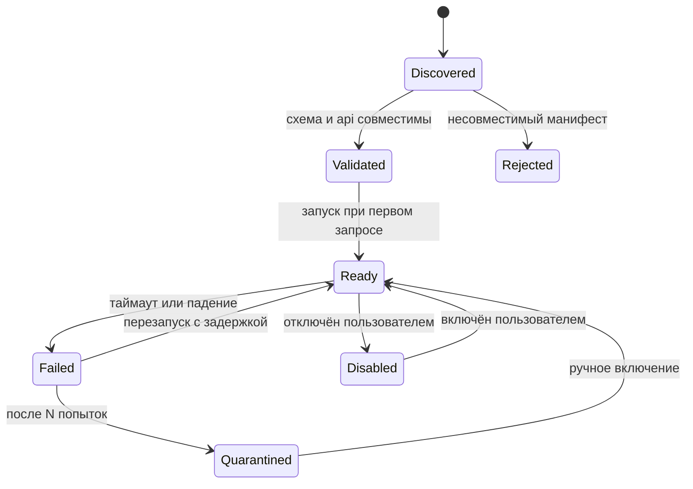
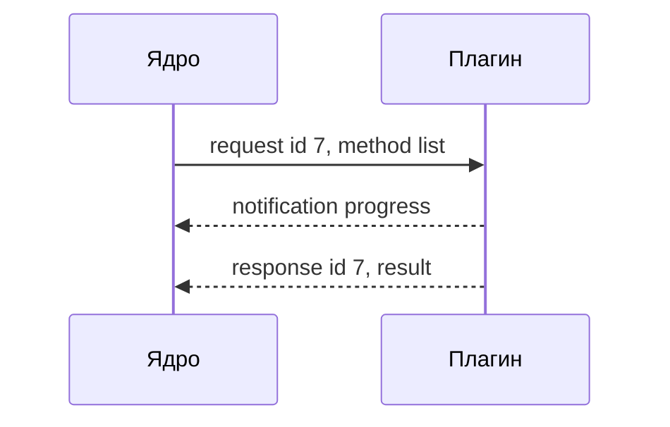

# Плагины и JSON-RPC

> Оригинальная серия: [[Package Browser]]

## Зачем нужны плагины

Менеджеров пакетов много, и у каждого свои команды, форматы вывода и места хранения. Если зашить поддержку в ядро, каждый новый менеджер потребует правки и пересборки приложения. Плагины решают это: ядро знает только общий интерфейс, а всё специфичное живёт снаружи.

Большинство менеджеров — это CLI, у которого есть команда «выведи список» с разбираемым выводом. Для них достаточно описания в файле, без кода. Только сложные случаи (чтение файлов базы менеджера, нестандартные форматы) требуют настоящей программы.

## Два уровня плагина за одним интерфейсом

Ядро работает с одним интерфейсом `IProvider` и не знает, какой транспорт за ним стоит.

| Транспорт | Когда подходит | Цена |
| --- | --- | --- |
| Декларативный адаптер (`plugin.toml`, кода нет) | CLI с JSON- или строчным выводом: pip, npm, многие другие | нулевая вероятность ошибок в коде плагина; гибкость ограничена выразительностью манифеста |
| Внешний процесс, JSON-RPC 2.0 по stdio | нужна логика: чтение файлов базы менеджера, нестандартные форматы, обход медленного CLI | запуск процесса и сериализация вызовов; зато полная изоляция и любой язык |
| Встроенный класс C++ в хосте | только первостороннее и тестовые заглушки | быстрее всего, но падение плагина — падение приложения; публичного API нет |

Нативные DLL для сторонних авторов не поддерживаются: сбой одного плагина роняет весь хост, а привязка к ABI отнимает главное преимущество «пиши на чём угодно».

## Манифест `plugin.toml`

> [!warning]
> Это набросок формата, а не готовый стандарт. Флаги команд нужно проверить на целевых версиях менеджеров.

Пример для pip:

```toml
[plugin]
id = "builtin.pip"
api = 1                       # версия контракта хоста
name = "pip"
ecosystem = "python"
capabilities = ["detect", "locate", "list"]

[tool]
executables = ["pip", "pip3"]
version_cmd = ["{exe}", "--version"]
version_regex = "^pip (?P<version>\\S+)"

[[locator]]                   # глобальное окружение = относительно найденного в PATH инструмента
scope = "system"
from = "path"

[[locator]]                   # project-local: каталог с файлом-маркером
scope = "project"
marker = "pyvenv.cfg"
tool_in_root = ["bin/pip", "Scripts/pip.exe"]

[list]
command = ["{tool}", "list", "--format=json"]
format = "json-array"         # [{"name": ..., "version": ...}]
name = "name"
version = "version"
```

Процессный провайдер объявляется секцией `[provider] exec = ["python", "vcpkg_provider.py"]` вместо `[tool]`, `[locator]` и `[list]`.

> [!warning]
> `npm ls` может возвращать ненулевой код выхода, когда в дереве зависимостей есть проблемы, но всё равно выводить корректный JSON. Это нужно проверить. Манифест должен уметь объявлять допустимые коды выхода (например, `ok_exit_codes`), иначе хост сочтёт такой вызов ошибкой.

## Жизненный цикл плагина



Отключённый плагин не загружается, поэтому его окружения не сканируются; их данные в кэше остаются нетронутыми и видимыми до повторного включения плагина (не удаляются и не помечаются неактуальными).

---

## Что такое JSON-RPC

Если вы никогда не работали с JSON-RPC, идея простая: **ядро вызывает функции в другой программе так, как будто они лежат рядом.** Просто «вызов функции» записан в виде JSON-сообщения, а доставляется через stdin/stdout дочернего процесса.

Это очень похоже на общение с HTTP-сервером, только без сети: вместо URL и порта есть процесс, который ядро запустило само. Соответствие такое:

| В HTTP/REST | В JSON-RPC |
| --- | --- |
| путь или имя эндпоинта | `method` |
| тело запроса | `params` |
| успешный ответ | `result` |
| код и текст ошибки | `error` |
| идентификатор потока (HTTP/2) | `id`: связывает ответ с запросом |

### Как выглядит обмен

Ядро запрашивает список пакетов окружения:

```json
{"jsonrpc":"2.0", "id":7, "method":"list",
 "params":{"environment":{"id":"e_9f2c","root":"/work/app/.venv"}}}
```

Плагин отвечает, повторяя `id`:

```json
{"jsonrpc":"2.0", "id":7,
 "result":{"installations":[{"name":"requests","version":"1.2.3"}], "complete":true}}
```

При ошибке вместо `result` приходит `error`:

```json
{"jsonrpc":"2.0", "id":7,
 "error":{"code":-32000, "message":"vcpkg_installed not found", "data":{"kind":"EnvBroken"}}}
```

Коды от `-32700` до `-32600` зарезервированы самим стандартом (например, `-32601` значит «такого метода нет»). Свои коды лучше брать из диапазона `-32000..-32099`.

Есть ещё сообщения без `id`, они называются notifications: ответа на них никто не ждёт. Так плагин может присылать прогресс, пока выполняется долгий запрос:

```json
{"jsonrpc":"2.0", "method":"progress", "params":{"requestId":7, "done":120, "total":400}}
```

Отмена работает так же: ядро шлёт `{"jsonrpc":"2.0","method":"$/cancel","params":{"id":7}}`. Если плагин завис, ядро просто убивает процесс по таймауту.



Поле `id` нужно потому, что запросов может быть несколько одновременно, и ответы могут приходить не по порядку. По `id` ядро находит, на какой запрос пришёл ответ.

### Рамка `Content-Length`

Stdin и stdout — это поток байтов, и сообщения в нём не имеют границ. Поэтому перед каждым JSON идёт заголовок с длиной:

```
Content-Length: 94\r\n
\r\n
{"jsonrpc":"2.0","id":7,"method":"list",...}
```

Читающая сторона читает заголовок, потом ровно столько байт, сколько в нём указано. Так делает и протокол LSP, который знаком по IDE. Можно упростить до «один JSON на строку», но тогда нельзя переносить строки внутри сообщения. Выбор рамки — наше решение, это не часть стандарта JSON-RPC.

### Минимальный плагин на Python

> [!warning]
> Это набросок, он не проверен на реальном менеджере. Он показывает идею: плагин читает запрос, отвечает и больше ничего не знает о ядре.

```python
import sys, json

def read_message():
    headers = {}
    while True:
        line = sys.stdin.buffer.readline()
        if not line:
            return None                      # ядро закрыло канал
        line = line.strip()
        if not line:
            break                            # пустая строка = конец заголовков
        k, v = line.decode().split(":", 1)
        headers[k.lower()] = v.strip()
    body = sys.stdin.buffer.read(int(headers["content-length"]))
    return json.loads(body)

def send(msg):
    data = json.dumps(msg).encode()
    sys.stdout.buffer.write(b"Content-Length: %d\r\n\r\n" % len(data) + data)
    sys.stdout.buffer.flush()

while (req := read_message()) is not None:
    if req["method"] == "list":
        pkgs = [{"name": "requests", "version": "1.2.3"}]   # здесь реальная логика плагина
        send({"jsonrpc": "2.0", "id": req["id"],
              "result": {"installations": pkgs, "complete": True}})
    else:
        send({"jsonrpc": "2.0", "id": req["id"],
              "error": {"code": -32601, "message": "Method not found"}})
```

> [!warning]
> В stdout можно писать только протокол. Любой отладочный `print` сломает разбор сообщений, поэтому логи идут в stderr.

### Сторона ядра на C++/Qt

> [!warning]
> Тоже набросок, не готовый код.

```cpp
QProcess provider;
provider.start("python", {"vcpkg_provider.py"});

QHash<int, std::function<void(const QJsonObject&)>> pending;   // id -> что сделать с ответом
int nextId = 1;

auto call = [&](const QString& method, const QJsonObject& params, auto onResult) {
    int id = nextId++;
    pending[id] = onResult;
    QByteArray body = QJsonDocument(QJsonObject{
        {"jsonrpc", "2.0"}, {"id", id}, {"method", method}, {"params", params}
    }).toJson(QJsonDocument::Compact);
    provider.write("Content-Length: " + QByteArray::number(body.size()) + "\r\n\r\n" + body);
};

// readyReadStandardOutput: накопить байты, вырезать сообщение по Content-Length,
// найти pending[msg["id"]] и вызвать его с msg["result"] (или обработать msg["error"]).
```

`call("list", {...}, callback)` ничего не блокирует: ядро шлёт запрос и продолжает работать, а когда приходит ответ, вызывается callback. Поэтому интерфейс не зависает на медленном `npm ls`.

---

## Контракт провайдера

Контракт состоит из четырёх чистых операций чтения. Они не меняют состояние окружения, поэтому их можно безопасно повторять, отменять по таймауту и параллелить.

| Операция | Вход | Выход |
| --- | --- | --- |
| `detect` | контекст хоста: `PATH`, платформа, среда | список `ToolInstance`: путь, версия |
| `locate` | `ToolInstance` или корень сканирования | список `Environment`: `scope`, `root`, `inheritsFrom` |
| `fingerprint` | `Environment` | строка, меняющаяся при изменении содержимого; дешёвая операция |
| `list` | `Environment`, опционально `withDependencies` | поток `Installation` (и `DependencyEdge`) порциями |

Резерв на будущее, без реализации в MVP: `plan` (что изменится, сухой прогон) и `apply` (выполнить, с прогрессом и отменой). Имена лёгко добавить сейчас и дорого вставлять потом. Подробнее — в [[Решения и roadmap]].

## Правила контракта

| Тема | Правило |
| --- | --- |
| Версионирование | хост при запуске передаёт свой `api`, плагин отвечает списком поддерживаемых; новые поля добавляются без подъёма версии, неизвестные поля игнорируются |
| Честный «не знаю» | поле может быть `null` (например, `direct` у pip), а `complete: false` говорит, что список частичный; UI показывает это, а не притворяется |
| Ошибки | типизированные коды `ToolNotFound`, `EnvBroken`, `Timeout`, `ParseFailed`, `Untrusted`, `Unsupported`; доходят до UI как статус окружения, а не как исключение |
| Отмена и таймауты | у каждого запроса дедлайн на стороне хоста; по истечении хост убивает процесс или шлёт `$/cancel` |
| `capabilities` | плагин явно заявляет, что умеет; операция вне списка не вызывается, UI не показывает соответствующую кнопку |

## Другие RPC-протоколы

Протоколы различаются форматом данных и транспортом. JSON-RPC определяет только протокол вызова, поэтому его можно положить на любой транспорт.

| Протокол | Формат данных | Транспорт | Особенности |
| --- | --- | --- | --- |
| JSON-RPC 2.0 | JSON (текст) | любой: stdio, сокет, HTTP, WebSocket | минимальная спецификация; библиотеки есть везде; используют LSP и MCP |
| gRPC | Protobuf (бинарный) | HTTP/2 | схема в `.proto`, кодогенерация; потоки в обе стороны и дедлайны |
| Apache Thrift | свой бинарный формат или JSON | сокеты, HTTP | похож на gRPC, менее популярен |
| Cap'n Proto | собственный бинарный формат без разбора | сокеты, каналы | очень быстрый, экосистема меньше |
| XML-RPC | XML | HTTP | старый предшественник JSON-RPC, сейчас редок |
| MessagePack-RPC | MessagePack | сокеты, stdio | близок к JSON-RPC, используется, например, в Neovim |
| D-Bus | бинарный формат | локальная шина Linux | стандарт для системных сервисов на Linux |
| COM / DCOM | бинарный формат Windows | локально или по сети | только Windows |
| Qt Remote Objects | Qt-сериализация | сокеты, локальные каналы | прозрачный доступ к объекту из другого процесса, но жёстко привязывает плагины к Qt |

Для приложения выбран JSON-RPC по stdio: плагины на любом языке без кодогенерации, сообщения читаются глазами, нет портов и сетевой поверхности атаки. gRPC избыточен: ему нужен HTTP/2 и генератор кода. Он имеет смысл только для удалённых плагинов или очень больших объёмов данных. Это оценка без замеров на реальных данных.

## См. также

- [[Package Browser]]
- [[Доменная модель]]
- [[Надёжность и безопасность]]
- [[Решения и roadmap]]
