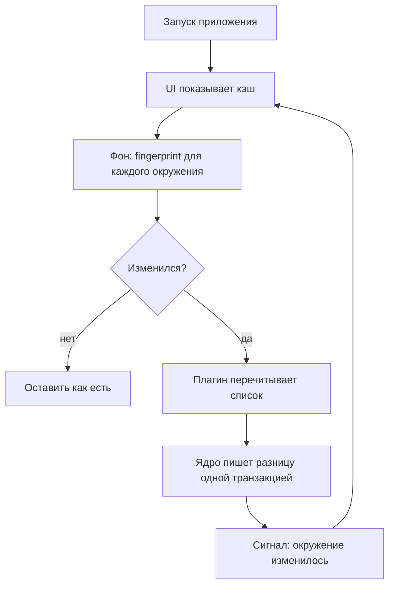

# Хранилище и кэш

> Оригинальная серия: [[Package Browser]]

## Зачем кэш

Вызовы `npm ls` или `pip list` могут занимать секунды, а окружений бывает много. Если интерфейс ждёт ответа менеджера при каждом открытии, он тормозит. Поэтому UI всегда читает из кэша, а менеджеры опрашиваются в фоне.

Главное правило: **источник истины — сами окружения на диске, а база — только кэш**, который можно удалить и пересобрать без потерь. Это упрощает миграции (при несовпадении версии схемы базу просто пересоздают) и убирает целый класс багов вида «кэш разошёлся с реальностью».

Хранилище — SQLite через Qt SQL (драйвер `QSQLITE`). Настройки пользователя (корни сканирования, доверенные корни, отключённые плагины, глубина сканирования) хранятся отдельно, **в INI-файле рядом с приложением** (`package-browser.ini`, `QSettings` в формате IniFormat через `AppSettings`), и переживают сброс кэша. Если каталог приложения недоступен для записи (например, установка в `Program Files`), файл помещается в пользовательский каталог конфигурации (`QStandardPaths::AppConfigLocation`). Настроек в системном реестре нет.

## Пример на сквозной машине

При первом запуске UI пуст, фоновый скан находит окружения из [[Обнаружение окружений]] и заполняет базу. При втором запуске окно сразу показывает данные из кэша, а в фоне для каждого окружения считается `fingerprint`. У `~/work/app/.venv` он не изменился, значит, ничего перечитывать не нужно. У `node_modules` он изменился (поставили пакет), поэтому плагин npm перечитывает список, ядро записывает разницу и шлёт сигнал, а таблица обновляется на месте.



## Схема

```sql
CREATE TABLE tool_instance (
  id TEXT PRIMARY KEY,           -- hash(plugin_id, real_path)
  plugin_id TEXT NOT NULL,
  real_path TEXT NOT NULL,
  version TEXT,
  provided_by_env TEXT          -- NULL: установлен в системе; иначе лежит внутри окружения
);
CREATE TABLE environment (
  id TEXT PRIMARY KEY,           -- hash(plugin_id, canonical root)
  plugin_id TEXT NOT NULL,
  scope TEXT NOT NULL CHECK (scope IN ('system','user','project')),
  root TEXT NOT NULL,
  tool_id TEXT REFERENCES tool_instance(id),
  inherits_from TEXT REFERENCES environment(id),
  fingerprint TEXT,              -- дешёвый хэш «что-то изменилось»
  scanned_at INTEGER,
  status TEXT NOT NULL           -- ok | stale | error | missing
);
CREATE TABLE installation (
  env_id TEXT NOT NULL REFERENCES environment(id) ON DELETE CASCADE,
  name_norm TEXT NOT NULL,       -- нормализованное правилами экосистемы
  name_display TEXT NOT NULL,
  version TEXT,
  location TEXT,
  is_direct INTEGER,             -- запрошен явно; NULL, если менеджер не знает
  PRIMARY KEY (env_id, name_norm)
);
CREATE TABLE dependency (
  env_id TEXT NOT NULL, from_name TEXT NOT NULL,
  to_name TEXT NOT NULL, constraint_text TEXT,
  PRIMARY KEY (env_id, from_name, to_name)
);
```

> [!note]
> На этапе 4 «Глубина» таблица `dependency` заполняется: `from_name`/`to_name` — нормализованные имена пакетов, `constraint_text` — версионное ограничение (может быть пустым, если менеджер его не знает). Рёбра пишутся в `replaceEnvironment` одной транзакцией с установками. Плоский список без рёбер оставался поведением MVP (этапы 1–3).

## Решения

| Тема | Решение | Причина |
| --- | --- | --- |
| Идентификаторы | `environment.id` — хеш от плагина и канонического корня | повторный скан обновляет ту же строку; перенос каталога venv даёт новое окружение, а старое получает `status = missing` |
| Нормализация имён | правила принадлежат экосистеме ([[Доменная модель]]); ядро вызывает нормализатор | ядро не знает правил конкретных менеджеров |
| Инвалидация | stale-while-revalidate: UI показывает кэш, в фоне считается `fingerprint`; при расхождении плагин перечитывает список, ядро пишет разницу одной транзакцией и шлёт сигнал | интерфейс не зависит от скорости менеджера |
| Недоступное окружение | не удаляется молча: получает `status = missing` и скрывается фильтром | диск мог быть просто отмонтирован; окончательная очистка — по кнопке или после долгого срока |
| Миграции | кэш одноразовый: при несовпадении версии схемы (`PRAGMA user_version`) база пересоздаётся | проще, чем вести миграции для данных, которые можно получить заново |

## Потоки и соединения

Qt SQL: одно соединение `QSqlDatabase` нельзя передавать между потоками, поэтому каждый поток открывает своё с уникальным именем. `CatalogService`, опрос провайдеров и запись в SQLite живут в рабочем потоке; UI читает только через сигналы и слоты. См. [[UI на Qt]].

## См. также

- [[Package Browser]]
- [[Обнаружение окружений]]
- [[UI на Qt]]
- [[Решения и roadmap]]
